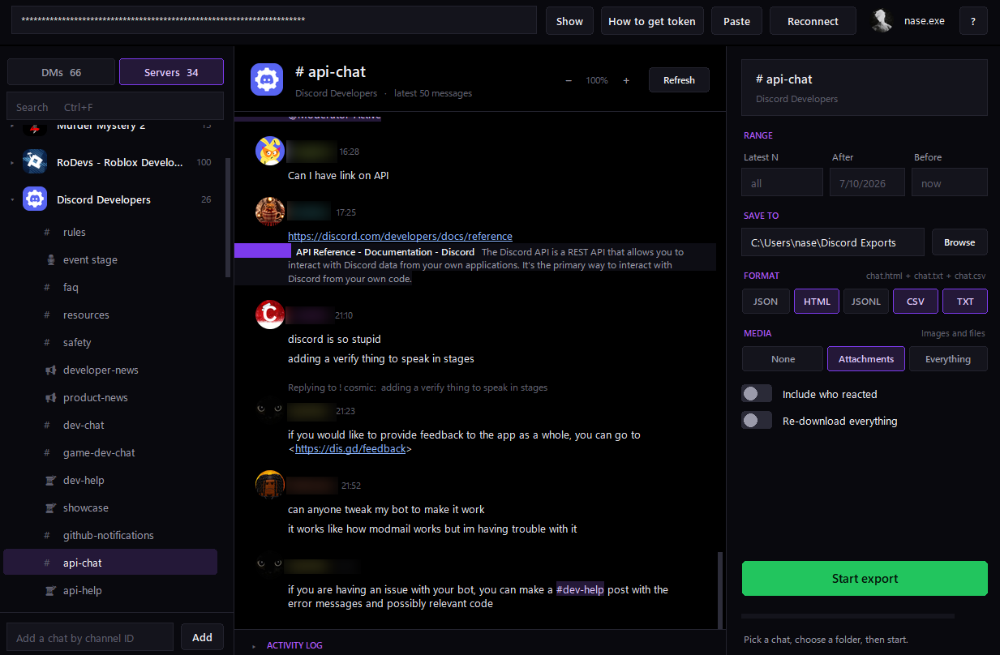
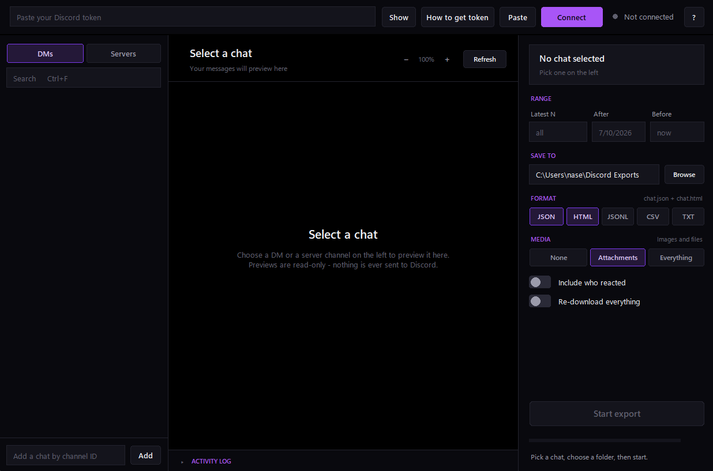
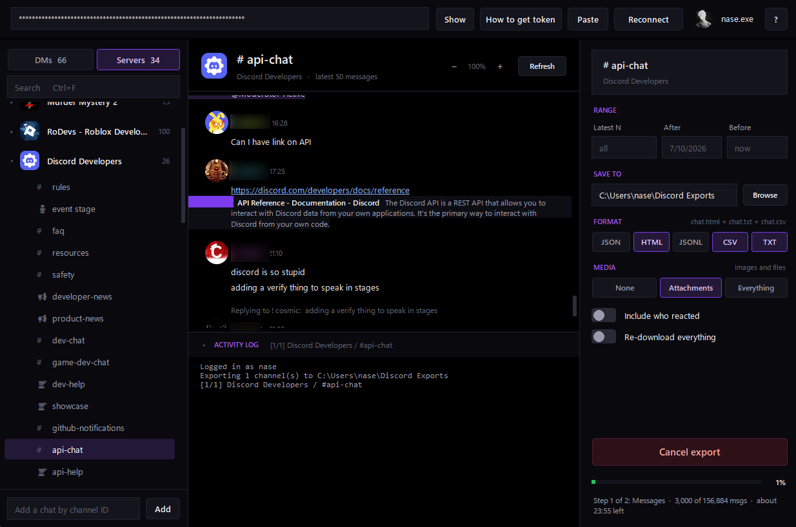

<div align="center">


# Restore

**Export your Discord chats and DMs to a clean, searchable archive.**
A desktop app and a command-line tool. Your messages and media are saved locally, so nothing expires or disappears.

</div>

---

## Screenshots

<p align="center">
  <br><br>
  <br><br>
  
</p>

## Features

- **Desktop app** with a dark OLED theme, sharp on high-DPI screens: a sidebar with **DMs / Servers tabs** and search (round avatars, server icons, channel types), your own profile picture next to your name once connected, a read-only chat preview laid out like the HTML report (grouped messages, clickable links, highlighted mentions), and a side panel for export settings.
- **Full history export** with pagination and rate-limit handling built in.
- **Resumable and incremental:** re-run an export and only new messages are fetched.
- **Five formats:** JSON, JSONL, CSV, TXT, and a standalone searchable HTML viewer that opens at the very start of the conversation and keeps loading as you scroll down.
- **Rich content:** replies, reactions (optionally *who* reacted), embeds, polls, stickers, forwards, threads and resolved mentions.
- **Media downloads:** attachments (and optionally embed images, stickers, emoji and avatars) are saved locally so links never expire.
- **Accurate progress:** one bar across all steps (messages, reactions, media) that never goes backwards, with counts ("1,234 of 3,700") and a time-left estimate based on the real pace of the current run. The total comes from Discord's own message count when available, and falls back to a timestamp-based estimate otherwise. Plus a sound when it finishes, and a **Cancel** button that stops safely (progress is kept, run again to resume).
- **Private by design:** your token is kept in memory only and is never written to disk or logs.

## Quick start (Windows `.exe`)

Build it once, then double-click:

```bash
pip install -r requirements.txt pyinstaller
python -m PyInstaller --onefile --windowed --name Restore --add-data "Restore.png;." discord_export_gui.py
```

The app appears in `dist/Restore.exe`.

## Run from source

Requires Python 3.9+ and Tkinter (included with the python.org installer).

```bash
pip install -r requirements.txt   # Pillow is optional: it gives smooth round avatars
python discord_export_gui.py        # desktop app
python discord_export.py            # interactive command-line menu
```

## Using the app

1. Paste **your own** Discord token. It connects automatically (or press **Connect**; **Show**, **Paste** and a **How to get token** video link sit next to the box). Your DMs and servers appear right away, server channels fill in behind the scenes, and avatars load only for what's on screen. Everything downloaded for display (avatars, icons, emoji pictures) lives in memory only - nothing is written to disk. Custom emoji come from Discord's CDN and standard emoji from the open-source Twemoji set on jsDelivr; your token is never sent to either.
2. Click a DM or a server channel to preview its recent messages.
3. Pick a range, formats and media options in the panel on the right, then click **Start export**. Click it again to cancel.
4. Run the same export again later to pull in only what's new.

> **DMs missing?** Discord's API only returns DMs that are currently open in your client. Use **Add a chat by channel ID** under the chat list to add any other DM.

## Command-line usage

```bash
export DISCORD_TOKEN="..."                   # or put it in a .env file, or enter it at the hidden prompt

python discord_export.py --list              # show DMs and servers with their IDs
python discord_export.py -c 123456789012345678              # whole history of one chat
python discord_export.py -c 1234... -n 2000                 # most recent 2000 messages
python discord_export.py -c 1234... --after 2025-01-01 --before 2025-02-01 -f json,csv,html
python discord_export.py -g 9876... --threads               # every text channel of a server
python discord_export.py -c 1234... --media all --reactors  # archive everything
```

| Option | Description |
| --- | --- |
| `-c ID` | Channel / DM / thread ID (repeat or comma-separate) |
| `-g ID` | Export every text channel of a server |
| `--all-dms` | Export all your DMs and group chats |
| `--threads` | Include threads (active and archived public) |
| `-n N`, `--after`, `--before` | Limit by count, or by date / relative time (`7d`, `12h`) / message ID |
| `-f LIST` | `json,jsonl,csv,txt,html` or `all` (default `json,html`) |
| `--tz TZ` | `local` (default), `utc` or an IANA name such as `Europe/Istanbul`. Exports label times as `UTC+3`-style offsets. |
| `--media` | `none`, `attachments` or `all` |
| `--max-media-mb MB` | Skip files larger than this |
| `--reactors` | Record who reacted (extra requests) |
| `--fresh` | Ignore the cache and re-download everything (refreshes edits and deletions) |
| `--delay SEC` | Pause between requests (default 0.3) |
| `--bot` | The token is a bot token |

Run `python discord_export.py --help` for the full list.

## Getting your token

Restore needs the token of the account you're exporting from. Treat it like a password: anyone who has it controls your account. Never paste a token or run a script from someone else, and be suspicious of anyone who asks you to paste code into Discord's developer console. That's a common account-theft scam. Restore deliberately doesn't ship a one-click token grabber.

## Tests

```bash
python -m unittest test_discord_export
python -m unittest test_gui_core
python -m unittest test_ui_smoke      # run each file separately
```

The exporter tests run against a mock local Discord server, the GUI tests cover all non-UI logic, and the UI smoke test builds the whole window against a fake Tk to catch wiring errors.

## Disclaimer

Discord's Terms of Service prohibit automating **user** accounts. Slow, read-only exports of your own chats are common and rarely flagged, but the risk is not zero and you use this at your own risk. For servers you manage, a bot token (`--bot`) is the sanctioned route. Restore is not affiliated with or endorsed by Discord.

## License

MIT. See [LICENSE](LICENSE). You're free to use, modify and fork Restore, but the copyright notice (Copyright (c) 2026 nase) must stay in every copy and fork.
